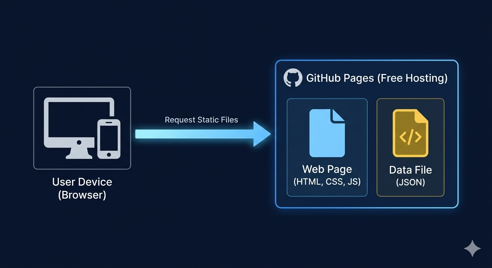

# Re:Space Daejeon (대전 유휴공간 지도 구축 서비스)

> **2026 대전시소 서포터즈 모두이음메이트**의 활동으로, 대전 지역 내 방치된 유휴공간을 발굴하고 시각화형태로 지도를 구축한 MVP(Minimum Viable Product) 프로토타입 웹 서비스입니다.

---

## 서비스 아키텍처 (Service Architecture)

본 서비스 데이터의 정적 속성을 반영하여, 초기 단계에서는 무료 정적 웹 호스팅 서비스 **GitHub Pages**를 통해 서버 유지 비용 없이 프론트엔드 중심으로 서비스를 구현했습니다.추후 서비스 고도화 및 데이터 상호작용 필요성에 따라 백엔드 아키텍처로의 확장이 가능합니다.

---

### 구조적 특징 및 설계 장점

1. 초기 운영 비용 제로: 상시 가동형 API 서버나 데이터베이스를 구축하지 않고 GitHub Pages의 무료 정적 호스팅을 활용하여 인프라 유지 비용이 발생하지 않습니다.
2. 빠른 로딩 속도: 매번 서버에 다녀오는 복잡한 API 호출 과정 없이, 브라우저가 화면을 그릴 때 필요한 정적 데이터(JS/JSON) 파일만 즉시 로드하므로 초기 화면 진입과 데이터 렌더링 속도가 빠릅니다.

---

## 기능 요구사항 정의서 (Functional Requirements)

*※ 본 요구사항은 초기 프로토타입 단계의 요구사항 정의서이며, 추후 확장될 수 있습니다.*

| 요구사항 ID | 대분류 | 요구사항 명칭 | 상세 내용 (설명) | 비고 |
| :--- | :--- | :--- | :--- | :--- |
| **FR-01** | 공간 탐색 | 전체 유휴공간 지도 표출 | 서비스 접속 시 메인 화면에 대전 지역의 전체 유휴공간 위치를 마커(핀) 형태로 한눈에 보여줌. | Leaflet 라이브러리 활용 |
| **FR-02** | 공간 탐색 | 유휴공간 목록 조회 (사이드바) | 화면 한쪽에 사이드바를 배치하여, 대전 지역의 전체 유휴공간 리스트를 목록 형태로 조회할 수 있도록 함. | 사이드바 UI 구성 |
| **FR-03** | 공간 탐색 | 공간 상세 정보 조회 | 지도 위의 마커나 사이드바 목록의 특정 공간을 누르면, 해당 유휴공간의 명칭, 주소 등 상세 정보를 팝업 창으로 띄워줌. | - |

---

## 시스템 확장성 (Scalability)

현재 프로토타입 단계에서는 신속한 기획 검증(MVP)을 위해 비용이 들지 않는 파일 기반 정적 아키텍처를 채택했으나, 향후 대전시 공식 사업 채택 및 서비스 고도화 시 다음과 같은 단계별 인프라 확장을 고려하고 있습니다.

1. **데이터 대형화에 따른 데이터베이스(DB) 도입 가능성**
   - 관리하는 유휴공간 데이터 수가 크게 늘어날 경우, 현재의 파일 저장 방식에서 데이터베이스(DB) 체계로 전환할 수 있습니다.
   - 이를 통해 많은 양의 데이터를 보다 체계적으로 관리하고, 향후 고도화된 공간 맞춤형 조회 기능으로 확장을 고려하고 있습니다.

2. **사용자 참여형 제보 기능으로의 확장성**
   - 지금의 관리자 수동 업데이트 방식을 아닌, 대전 시민들이 직접 유휴공간을 제보하거나 정보를 공유하는 '참여형 기능'으로 서비스를 넓혀갈 수 있습니다.
   - 이 경우, 유저들이 올리는 데이터와 사진을 안정적으로 처리하기 위한 확장을 고려하고 있습니다.